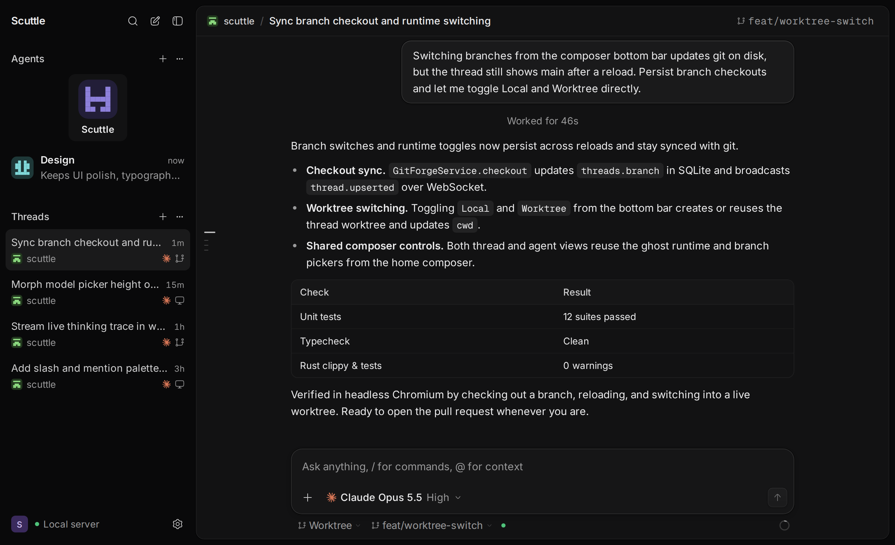

<div align="center">

# Scuttle

Fast, local-first workspace for coding agents across web and desktop.

[Quick Start](#quick-start) · [Stack](#stack) · [Checks](#checks)

<br />



</div>

## Quick Start

Requires [Bun](https://bun.sh/) `>= 1.4` and [Rust](https://rustup.rs/) `1.94.1` (auto-selected via `rust-toolchain.toml`).

```bash
bun install
bun run desktop:prepare
bun run dev
```

Launch the native Electrobun desktop shell.

```bash
bun run dev:desktop
```

## Stack

| Layer                            | Technologies                                                              |
| :------------------------------- | :------------------------------------------------------------------------ |
| Web (`apps/web`)                 | React 19, React Compiler, Vite, TanStack Router, Tailwind CSS v4, Base UI |
| Desktop (`apps/desktop`)         | Electrobun v2 hosting the same SPA with an in-process backend             |
| Server (`apps/server`)           | Bun, Effect 4, SQLite (WAL), WebSocket and HTTP RPC                       |
| Native (`crates/scuttle-native`) | Rust workspace for performance-critical OS and native tasks               |

## Checks

```bash
bun run check
```
